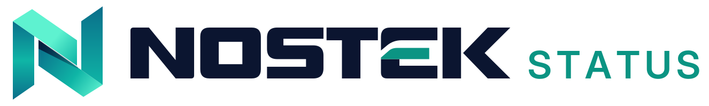

<p align="center">
  <picture>
    <source media="(prefers-color-scheme: dark)" srcset="assets/brand/nostek-status-on-dark.svg">
    
  </picture>
</p>

<p align="center">
  <b>Open-source status page that stays honest when everything else is down.</b><br>
  Check your services from the outside, show customers what is up, and never paint missing data green.
</p>

<p align="center">
  <a href="LICENSE"></a>
  
  
  
</p>

---

> **Status:** design phase. Nothing is installable yet. The design is public; code follows in small, tested steps.

## Why Nostek Status

A status page matters most on the day your own servers, network or data centre are in trouble. If the page runs
inside the same network, it goes down with everything else. Nostek Status is built to run **somewhere else**
(a small VPS, a different provider) and to tell the truth from there.

| | |
|---|---|
| 🌍 **Checks from the outside** | Probes your public URLs the way a customer reaches them: HTTP(S), TCP and DNS, every 60 seconds. |
| 🧘 **No flapping** | A service changes state only when **2 of its last 3** checks agree. One lost packet is not an outage. |
| 🚦 **Honest states** | Operational · Partial outage · Major outage · Maintenance · **Data delayed**. Missing or old data is never green. |
| ✍️ **Signed detail (optional)** | Your own monitoring can push extra detail (partial outages, maintenance, incident notes) as small **Ed25519-signed** snapshots. The page keeps only public keys. |
| 🧩 **Works with Uptime Kuma** | Use Uptime Kuma as the probe engine, or the built-in probe. |
| 📅 **Incidents and maintenance** | Active incidents with updates (investigating → identified → monitoring → resolved), planned maintenance, history. |
| 📊 **90-day uptime bars** | One bar per day per service, grouped by product. |
| 🎨 **Your brand** | Name, logo, colours, light / dark theme from settings. The Nostek theme is only the default. |
| 🌐 **Two languages, any time zone** | English and Indonesian out of the box; every time on screen shows its zone. |
| 🔒 **Small attack surface** | Static page, no cookies, strict Content Security Policy, one intake route with size, signature, audience, sequence and expiry checks. |

## How it works

```text
          Your customers                        Your own network (optional)
                │                                         │
                ▼                                         │  signed snapshot
   ┌──────────────────────────┐   POST /intake (Ed25519)  │  (aud, kid, seq, exp)
   │  status.example.com      │◄──────────────────────────┘
   │  Nostek Status           │
   │  ├─ page (static)        │
   │  ├─ merge + rules        │──── probes every 60 s ────► https://app.example.com
   │  └─ probe / Uptime Kuma  │                             https://api.example.com
   └──────────────────────────┘                             tcp mail.example.com:443
        runs OUTSIDE the network it watches
```

- The outside probe decides whether a service is **reachable**.
- Signed snapshots add **detail** that only your inside monitoring knows.
- If snapshots stop, the page keeps the probe results and says **"internal detail delayed since HH:MM (zone)"**.

## Signed snapshots in short

| Field | Rule |
|---|---|
| `aud` | must equal this page's name, so a snapshot made for another page is refused |
| `kid` | must be one of the pinned public keys (current + next, for rotation without downtime) |
| `seq` | must be higher than the last accepted one (replays and old snapshots are refused) |
| `iat` / `exp` | at most 5 minutes valid, 60 seconds clock skew |
| size / fields | at most 64 KB, only allow-listed fields |

A refused snapshot never replaces the last good one; the log records only the rule that refused it.

## Roadmap

1. Design and repository start ✅
2. Page + settings + locales (EN / ID), static build
3. Intake route with signature checks and a full refusal test set
4. Built-in probe with 2-of-3 rules; Uptime Kuma adapter
5. Incidents, maintenance, 90-day history
6. One-command install with Docker, and a ready app for [Nostek Panel](https://github.com/thuekx/docker-panel-VPS)

## Theming

The settings will carry `name`, `logo_light`, `logo_dark`, `accent` colour, `languages`, `default_language` and
`time_zone` (default `Asia/Jakarta`). Replace the Nostek logo with yours when you run it for your own service
(see [TRADEMARKS.md](TRADEMARKS.md)).

## Logo files

`assets/brand/` holds the Nostek Status logo in SVG (teal, blue and mono; for dark and light backgrounds) and PNG.
They are made by `assets/brand/src/build_brand.py`, the same generator as Nostek Panel, with the product word STATUS.

## Contributing, security, licence

- [CONTRIBUTING.md](CONTRIBUTING.md): how to propose changes.
- [SECURITY.md](SECURITY.md): report a vulnerability privately, never in a public issue.
- Code: [MIT](LICENSE). Name and logos: see [TRADEMARKS.md](TRADEMARKS.md).
- Support is community, best effort.

---

## Bahasa Indonesia

**Nostek Status** adalah halaman status open source yang tetap jujur saat semua yang lain sedang bermasalah.

- Dijalankan **di luar** jaringan yang dipantau (misalnya VPS kecil di provider lain), supaya tetap hidup saat server,
  jaringan atau data center Anda bermasalah.
- **Pengecek dari luar** mencoba URL publik Anda seperti pelanggan, tiap 60 detik. Status baru berubah kalau
  **2 dari 3** cek terakhir sepakat.
- Status yang jujur: Normal · Sebagian terganggu · Gangguan · Pemeliharaan · **Data tertunda**. Data yang hilang atau
  lama tidak pernah tampil hijau.
- **Detail bertanda tangan (opsional):** monitoring internal Anda bisa mengirim detail dengan tanda tangan
  **Ed25519**. Halaman hanya menyimpan kunci publik.
- Bisa memakai **Uptime Kuma** atau pengecek bawaan. Ada catatan gangguan, jadwal pemeliharaan, dan bar uptime 90 hari.
- Nama, logo, warna, bahasa (ID / EN) dan zona waktu diatur lewat pengaturan. Tema Nostek hanya bawaan.

Status: tahap desain, belum bisa dipasang. Kode berlisensi MIT; nama dan logo Nostek tidak (lihat
[TRADEMARKS.md](TRADEMARKS.md)). Laporan celah keamanan lewat **Security → Report a vulnerability**, jangan lewat issue
publik.
